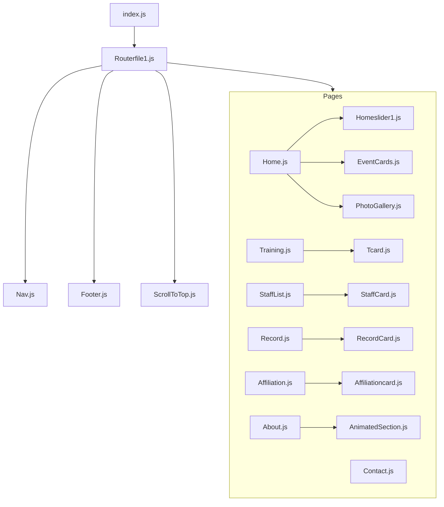

# Silambam Shadows - Project Study & Quality Analysis

This document provides a comprehensive analysis of the **Silambam Shadows** web application workspace. It covers the technical stack, codebase architecture, routing flow, component roles, and highlights several bugs, warnings, and code-quality improvements that should be addressed.

---

## 1. Project Technology Stack & Setup

*   **Core Framework:** React 19 (React `v19.1.0` and React DOM `v19.1.0`).
*   **Build & Dev Server:** Create React App (`react-scripts` v5.0.1).
*   **Routing:** React Router DOM v7 (`v7.5.3`).
*   **Animation System:** Framer Motion (`v12.23.24`) for scroll-linked and entry animations.
*   **Icons:** FontAwesome (`v6.7.2`) and React Icons (`v5.5.0`).
*   **Deployment:** Configured for **Firebase Hosting** (files `.firebaserc`, `firebase.json` are present).
*   **Styling:** Custom component-based Vanilla CSS sheets mapping page-by-page.

---

## 2. Directory & Architecture Map

The project is structured with high modularity, using clear separations of concerns:



### Component Roles & Paths

1.  **Entry Point & Routing:**
    *   [index.js](file:///d:/TAP/mywebsit/ss/src/index.js): Bypasses the default `App.js` and renders `<Routerfile1 />`.
    *   [Routerfile1.js](file:///d:/TAP/mywebsit/ss/src/router/Routerfile1.js): Defines standard layout including `Nav`, `Footer`, `ScrollToTop`, and handles route endpoints.
2.  **Navigation & Layout:**
    *   [Nav.js](file:///d:/TAP/mywebsit/ss/src/menu/Nav.js): Responsive sliding header with toggles and an "Apply Event" CTA leading to Google Forms.
    *   [Footer.js](file:///d:/TAP/mywebsit/ss/src/pages/Footer.js): Informational footer featuring corporate details, social icons, map redirects, and a smooth "scroll to top" button.
3.  **Core Page Components (`src/pages/`):**
    *   `Home.js`: Incorporates the responsive image carousel, objectives grid, and photo light-box.
    *   `Training.js`: Summarizes martial arts & yoga disciplines.
    *   `StaffList.js`: Highlights individual instructors with responsive overlay cards.
    *   `Record.js`: Spotlights records including world achievements.
    *   `Affiliation.js`: Highlights associations with external martial arts and yoga federations.
    *   `About.js`: Displays MD & Founder information and history.
    *   `Contact.js`: Embeds Google Maps, contact details, and a functional lead acquisition form that maps state fields directly into a Google Form POST request.
4.  **Reusable Widgets & Subcomponents:**
    *   `Tcard.js`: Reusable training card formatting focuses, methods, and benefits.
    *   `PhotoGallery.js` & `ImageModal.js`: Light-box enabled media gallery switching between "tournaments" and "papercuts" categories.
    *   `AnimatedSection.js`: Higher-order observer utilizing `react-intersection-observer` and `framer-motion` to fade/slide elements upon scrolling into view.

---

## 3. Discovered Issues & Technical Debt

During our study and build verification steps, we compiled a list of bugs, validation warnings, and improvements:

### 🚨 Critical Bug: Copy-Paste Content Error in `Training.js` (Karate Card)
The card representing the **Karate** training program (lines 81–93) has duplicate descriptions copied directly from the **Yoga** training card. 
*   *Yoga Focus:* "Flexibility, balance, and mental well-being."
*   *Karate Focus:* "Flexibility, balance, and mental well-being." (Should be striking, kata, self-defense, etc.)
*   *Karate Methods:* Mentions Asanas, Pranayama, Meditation, and Core strength. (Should be Kihon, Kata, Kumite, and striking drills).

### ⚠️ HTML Validation & JSX Warning: Invalid Nested Anchors
In [Contact.js:L166,L171](file:///d:/TAP/mywebsit/ss/src/pages/Contact.js#L166-L171) and [Footer.js:L45,L50](file:///d:/TAP/mywebsit/ss/src/pages/Footer.js#L45-L50), the code uses:
```jsx
<a className="contact-line" href="..." target="_blank">
  <FaMapMarkerAlt className="icon location" /> <a href='' />
  Sellur Madurai, Tamil Nadu
</a>
```
Nesting an empty `<a>` element (`<a href='' />`) directly inside another `<a>` tag is invalid HTML structure. This generates React DOM errors and compilation warnings:
*   `jsx-a11y/anchor-has-content`
*   `jsx-a11y/anchor-is-valid`

### ⚠️ Typos in `package.json`
The dependency version for `react-scripts` is listed with a stray single quote:
```json
"react-scripts": "50'.0.1"
```
While the local `node_modules` is currently resolved to `5.0.1`, this broken range will fail or cause unexpected resolutions when running `npm install` on other machines or in CI/CD build environments.

### 💡 Semantic HTML Validation in `Tcard.js`
In [Tcard.js:L14](file:///d:/TAP/mywebsit/ss/src/cards/Tcard.js#L14), a nested `<ul>` is rendered directly as a child of another `<ul>` instead of being enclosed inside a list item `<li>`:
```jsx
<ul>
  <li><strong>Focus:</strong> {focus}</li>
  <li><strong>Training Methods:</strong></li>
  <ul> {/* Invalid: nested ul must be inside a li element */}
    {trainingMethods.map((method, index) => (
      <li key={index}>{method}</li>
    ))}
  </ul>
</ul>
```

### 🧹 Dead Code: GSAP `SplitText.js` Dependency
The animation file `src/animation/SplitText.js` relies on `gsap/SplitText` plugins. However:
1.  `gsap` is **not** listed as a dependency in `package.json`.
2.  `SplitText.js` is **never imported** anywhere else in the application, making it unused dead code.

---

## 4. Proposed Fixes & Diffs

Here are the precise modifications to resolve all warning and styling elements:

### 1. Correcting the Karate Description inside `Training.js`
Modify [Training.js:L81-L93](file:///d:/TAP/mywebsit/ss/src/pages/Training.js#L81-L93):
```diff
                 <Tcard
                     imageSrc={img5}
                     altText="Karate"
                     title="Karate"
-                    focus="Flexibility, balance, and mental well-being."
-                    trainingMethods={[
-                        "Asana practice (postures that build strength and flexibility)",
-                        "Pranayama (breathing techniques to improve focus and relaxation)",
-                        "Meditation (to enhance mental clarity and concentration)",
-                        "Core strengthening (for stability and endurance)"
-                    ]}
-                    keyBenefit="Enhances body awareness, reduces stress, and improves overall health."
+                    focus="Striking, kicking, blocking, and hand-to-hand self-defense."
+                    trainingMethods={[
+                        "Kihon (mastery of fundamental blocks, punches, and kicks)",
+                        "Kata (patterned martial movements to improve form and memory)",
+                        "Kumite (controlled sparring to apply techniques in real time)",
+                        "Physical conditioning (strength, speed, and cardiovascular stamina)"
+                    ]}
+                    keyBenefit="Builds explosive speed, muscle memory, self-defense skills, and confidence."
                 />
```

### 2. Fixing Invalid Nested Anchors inside `Contact.js`
Modify [Contact.js:L163-L174](file:///d:/TAP/mywebsit/ss/src/pages/Contact.js#L163-L174):
```diff
           <h2>Branch</h2>
-          <a className="contact-line" href="https://www.google.com/maps?q=9.9386572,78.1236527"
-            target="_blank">
-            <FaMapMarkerAlt className="icon location" /> <a href='' />
-            Sellur Madurai, Tamil Nadu
-          </a>
-          <a className="contact-line" href="https://www.google.com/maps/place/9%C2%B059'11.8%22N+78%C2%B006'52.5%22E/@9.9866083,78.1120084,817m/data=!3m2!1e3!4b1!4m4!3m3!8m2!3d9.9866083!4d78.1145833!5m1!1e2?hl=en&entry=ttu&g_ep=EgoyMDI1MTIwOS4wIKXMDSoASAFQAw%3D%3D"
-            target="_blank">
-            <FaMapMarkerAlt className="icon location" /> <a href='' />
-            Vagaikulam Madurai, Tamil Nadu
-          </a>
+          <a className="contact-line" href="https://www.google.com/maps?q=9.9386572,78.1236527"
+            target="_blank" rel="noopener noreferrer">
+            <FaMapMarkerAlt className="icon location" />
+            Sellur Madurai, Tamil Nadu
+          </a>
+          <a className="contact-line" href="https://www.google.com/maps/place/9%C2%B059'11.8%22N+78%C2%B006'52.5%22E/@9.9866083,78.1120084,817m/data=!3m2!1e3!4b1!4m4!3m3!8m2!3d9.9866083!4d78.1145833!5m1!1e2?hl=en&entry=ttu&g_ep=EgoyMDI1MTIwOS4wIKXMDSoASAFQAw%3D%3D"
+            target="_blank" rel="noopener noreferrer">
+            <FaMapMarkerAlt className="icon location" />
+            Vagaikulam Madurai, Tamil Nadu
+          </a>
```

### 3. Fixing Nested Anchors inside `Footer.js`
Modify [Footer.js:L42-L53](file:///d:/TAP/mywebsit/ss/src/pages/Footer.js#L42-L53):
```diff
           <h2>Branch</h2>
-                    <a className="contact-line" href="https://www.google.com/maps?q=9.9386572,78.1236527"
-                      target="_blank">
-                      <FaMapMarkerAlt className="icon location" /> <a href='' />
-                      Sellur Madurai, Tamil Nadu
-                    </a>
-                    <a className="contact-line" href="https://www.google.com/maps/place/Silambam+Shadows"
-                      target="_blank">
-                      <FaMapMarkerAlt className="icon location" /> <a href='' />
-                      Vagaikulam Madurai, Tamil Nadu
-                    </a>
+                    <a className="contact-line" href="https://www.google.com/maps?q=9.9386572,78.1236527"
+                      target="_blank" rel="noopener noreferrer">
+                      <FaMapMarkerAlt className="icon location" />
+                      Sellur Madurai, Tamil Nadu
+                    </a>
+                    <a className="contact-line" href="https://www.google.com/maps/place/Silambam+Shadows"
+                      target="_blank" rel="noopener noreferrer">
+                      <FaMapMarkerAlt className="icon location" />
+                      Vagaikulam Madurai, Tamil Nadu
+                    </a>
```

### 4. Cleaning `package.json` react-scripts Typo
Modify [package.json:L21](file:///d:/TAP/mywebsit/ss/package.json#L21):
```diff
-    "react-scripts": "50'.0.1",
+    "react-scripts": "^5.0.1",
```

### 5. Fixing Nested List Semantics in `Tcard.js`
Modify [Tcard.js:L13-L19](file:///d:/TAP/mywebsit/ss/src/cards/Tcard.js#L13-L19):
```diff
-          <li><strong>Training Methods:</strong></li>
-          <ul>
-            {trainingMethods.map((method, index) => (
-              <li key={index}>{method}</li>
-            ))}
-          </ul>
+          <li>
+            <strong>Training Methods:</strong>
+            <ul>
+              {trainingMethods.map((method, index) => (
+                <li key={index}>{method}</li>
+              ))}
+            </ul>
+          </li>
```
